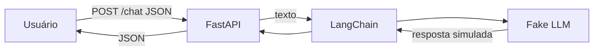

# Parte 2 - Questão 1: Chatbot com Fake LLM

Protótipo de chatbot simples feito com LangChain e FastAPI. Em vez de um modelo real, usa um Fake LLM (`FakeListLLM`) que devolve respostas pré-definidas.

## Como executar

1. Crie e ative um ambiente virtual:
   ```
   python -m venv .venv
   .venv\Scripts\Activate.ps1
   ```
2. Instale as dependências:
   ```
   pip install -r requirements.txt
   ```
3. Rode a aplicação:
   ```
   uvicorn main:app --reload
   ```
4. Acesse http://127.0.0.1:8000/docs para testar.

## Exemplo de requisição

Rota `POST /chat` com o corpo:

```json
{"texto": "Olá"}
```

Resposta:

```json
{
  "pergunta": "Olá",
  "resposta": "Olá! Como posso ajudar?"
}
```

O Fake LLM devolve as respostas da lista em ordem, a cada requisição.

## Arquitetura



Fluxo de dados:

1. O usuário envia um texto em JSON para a rota `POST /chat`.
2. O FastAPI valida a entrada e repassa o texto ao LangChain.
3. O LangChain chama o Fake LLM, que devolve a próxima resposta pré-definida.
4. O FastAPI devolve a resposta ao usuário em JSON.

## Por que usar Fake LLM

O Fake LLM é útil para testes rápidos porque:

- **Não gasta dinheiro:** não faz chamadas a APIs pagas.
- **É instantâneo:** não há tempo de inferência nem de rede.
- **Não precisa de internet nem de chave de API:** qualquer pessoa roda o projeto sem configuração.
- **É previsível:** as respostas são conhecidas, o que facilita testes automatizados.
- **Valida a estrutura da aplicação:** permite testar o fluxo FastAPI → LangChain antes de ligar um modelo real, trocando apenas o objeto `llm`.